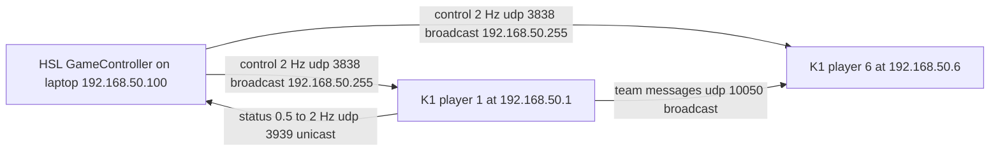

# HSL GameController — Lab Network Setup (team 50, 192.168.50.0/24)

How to run the official RoboCup HSL GameController
(https://github.com/RoboCup-HumanoidSoccerLeague/GameController) against
the K1 fleet in the lab, mimicking the venue network. Scope: **network
configuration only** — the GC runs standalone on a team laptop; robots
consume game state via the vendor brain (`game_controller_node`, see
`core/src/booster/ASSETS.md`). Feeding game state into ROS 2
(`referee_node.py` / bridge) remains future work (see `field_network.md`).

## Network model (HSL standard)

- One L2 network per team: `192.168.<team-number>.<robot-number>/24`.
  Our team number is 50 → team subnet `192.168.50.0/24`.
- Robots: static `192.168.50.<player>` (players 1..6 on the K1 fleet).
- Team PCs (GameController, debug laptops): static in the same subnet,
  outside the player range (e.g. `192.168.50.100`). **Each PC sets its
  own address in its own NetworkManager** — the shared wifi profile
  (`core/config/field_profiles/lab_hsl.env`) deliberately carries no
  PC address, so multiple PCs can share the profile.
- No gateway: the field subnet carries only match traffic.

## UDP channels of the GameController (IPv4 only)

| Channel | Direction | Port | Addressing |
|---|---|---|---|
| Control = game state, 2 Hz (temporarily 5 Hz when play is stopped) | GC → robots | 3838/udp | broadcast to the selected interface's broadcast address (`192.168.50.255`); `255.255.255.255` only if the launcher's Broadcast checkbox is set |
| Status return (`RoboCupGameControlReturnData`), 0.5–2 Hz | robots → GC | 3939/udp | unicast to the GC's address |
| Team messages (≤512 B, arbitrary format, counted by the GC per rules) | robot ↔ robot | 10050/udp (= 10000 + team 50) | broadcast `192.168.50.255` |
| Monitor registration (4 B magic `RGTr` + version byte) | monitor → GC | 3636/udp | unicast |
| Monitor true game state (magic `RGTD`) | GC → monitor | 3838/udp | unicast (monitors get the TRUE state; robots get the rule-compliant "fake" one after state transitions) |
| Monitor forwarded status | GC → monitor | 3940/udp | unicast, prefixed with the original sender's IPv4 address |

Message formats: `game_controller_msgs/headers/RoboCupGameControlData.h`
in the GC repo (`RoboCupGameControlData` and
`RoboCupGameControlReturnData` structs).

The GC binds to **one network interface** — set in the launcher
("Network Interface") or persistently via the `args` file. Lab launcher
settings: **Broadcast OFF** (the interface broadcast `192.168.50.255` is
correct for a single-interface laptop), **Multicast OFF** (simulation
only — never for real competition games).



## Setup workflow (Phases 1–5)

Uses the existing provisioning scripts (`field_network.md` documents
them). The lab AP is reconfigured from `192.168.0.0/24` to
`192.168.50.0/24` — same SSID (`R2k_Lab`), same password, only the
subnet changes. Why power-cycle instead of remote activation: the K1
cannot be shut down via `reboot` (manufacturer hardware limitation —
only a hard power-off works), and a subnet swap on the AP breaks the
old association anyway, so boot-time autoconnect is the natural
activation path.

### Phase 1 — install the HSL profile on every bot, NO activation

AP still on `192.168.0.x`, bots reachable at `192.168.0.10N`:

```bash
for N in 1 2 3 4 5 6; do
  ./utils/wifi/setup_K1_Network.sh --bot $N 192.168.0.10$N --exclusive --skip-up --profile lab_hsl
done
```

`--skip-up` replaces each bot's `field` profile with the
`192.168.50.<N>` static but does not activate it — the bots stay
reachable at `192.168.0.10N` (the SSID-named profile holds the link;
`--exclusive` sets it `autoconnect=no` so it will not compete after the
swap). Spot-check one bot:

```bash
ssh booster@192.168.0.104 'nmcli -g ipv4.addresses con show field'
# expected: 192.168.50.4/24
```

### Phase 2 — swap the AP subnet

Router web UI: LAN `192.168.0.0/24` → `192.168.50.0/24`; DHCP pool
excluding `.1`–`.6` (players) and the PC addresses (e.g. `.100`), or
DHCP off entirely (all static). SSID `R2k_Lab` + password unchanged.

### Phase 3 — laptop static address

On EVERY team PC that needs to reach the robots (set per PC, never in
the shared profile):

```bash
nmcli con mod R2k_Lab ipv4.method manual ipv4.addresses 192.168.50.100/24 ipv4.never-default yes
```

Pick any free address outside `.1`–`.6`.

### Phase 4 — hard power-cycle each K1, then validate

Walk to each bot, power off, power on. On boot NetworkManager
auto-activates the `field` profile (`autoconnect=yes`) and joins
`R2k_Lab` at `192.168.50.<N>`; the old SSID-named profile cannot
compete (`autoconnect=no`). Then from the laptop:

```bash
ping 192.168.50.4
ssh booster@192.168.50.4
sudo bash /home/booster/Workspace/r2k_wifi/wifi_check.sh \
    /home/booster/Workspace/r2k_wifi/lab_hsl.env --bot 4 --ping-peers
```

(The AP swap may push some bots onto `field` without a power-cycle —
the subnet change breaks the old association and `field` is the only
autoconnecting profile — but it is racy. Power-cycle is the guaranteed
path.)

### Phase 5 — run the GameController

1. **Install**: unpack the release archive from the GC repo's releases
   page, run `./install` (Linux; installs to `~/.local`), or run in
   place (`bin/GameController`).
2. **Config**: `GameController --install-config` copies the shipped
   configuration to the user's directory; `GameController --show-paths`
   prints the exact location used. Then edit:
   - Global `teams.yaml`: nothing to change — team 50
     ("R-ZWEI KICKERS") is already registered upstream.
   - Competition `<competition>/teams.yaml`: add `- 50  # R-ZWEI
     KICKERS` (upstream competition lists do NOT contain team 50).
     Ready-made copy: `core/config/gamecontroller/large_advanced/teams.yaml`.
     Details: `core/config/gamecontroller/README.md`.
3. **Persistent options** (`args` file next to the config dir, one
   line): `--interface <name>` for the interface holding
   `192.168.50.100` (e.g. `wlp3s0`). Command-line args override.
   `GameController -h` lists all flags.
4. **Launcher**: pick the `192.168.50.100` interface, the competition,
   team 50 as home or away, jersey colors, kick-off. Broadcast and
   Multicast checkboxes stay OFF.

## Firewall (laptop, if ufw is active)

```bash
sudo ufw allow in 3939/udp       # robots -> GC status (unicast)
sudo ufw allow in 10050/udp      # team messages (10000 + team 50, broadcast)
sudo ufw allow out 3838/udp      # GC -> robots (broadcast + monitor true-data)
# only if a monitor targets this GC:
sudo ufw allow in 3636/udp      # monitor registration
sudo ufw allow out 3940/udp     # monitor forwarded status
```

Robots (K1 side): whatever consumes the GC broadcast — the vendor
`game_controller_node` — must listen on `3838/udp`, return on
`3939/udp` to the GC's address (taken from the broadcast's source), and
teammate messaging uses `10050/udp`. If the K1 image runs a firewall,
open these; the vendor demo node handles the rest.

## Verification checklist

1. GC launcher shows team 50 in the team dropdown (needs the
   competition `teams.yaml` edit) and the `192.168.50.x` interface.
2. Start a game; on the laptop:
   `sudo tcpdump -i <iface> udp port 3838` → 2 Hz broadcasts to
   `192.168.50.255`.
3. The bots' `game_controller_node` logs state transitions (kick-off,
   playing, penalties) — proves receive on 3838.
4. The GC UI shows return/status data from each robot (status counters
   per player) — proves the robots' 3939 unicast reaches the GC.
5. `sudo tcpdump -i <iface> udp port 10050` → team broadcasts between
   bots while playing (and the GC counts them — the message budget
   resets to 0 on violation, a rule mechanism).
6. Full wifi validation per bot:
   `wifi_check.sh lab_hsl.env --bot N --ping-peers` all-PASS.

## At the venue

The organizers provide the field AP and run the official GC. What
carries over from this lab setup:

- The `venue_<city><year>.env` profile (copy `venue_draft.env`,
  `VENUE=match`, `FIELD_DEBUG_IP` empty — §3.9 laptop access during a
  match is a rule violation; debug exception is wired-only, ≤1 pkt/s
  per robot, §3.9.5).
- Provisions and validates identically: `setup_K1_Network.sh --profile
  venue_<city><year> --all --exclusive`, then `wifi_check.sh` per bot.
- The robots' GC ports (3838 in, 3939 out, 10050) and the
  `game_controller_node` are venue-ready as validated in the lab.
- Team PCs get their venue addresses from the organizers' assignment —
  again set per PC, never in the shared profile.

## Out of scope here

Feeding GC game state into ROS 2 (a `game_controller` subscriber node
publishing to `referee_node.py` / the bridge), the team
UDP-broadcast channel bridging, and `ROS_LOCALHOST_ONLY=1` for
cross-robot DDS — see `field_network.md`.